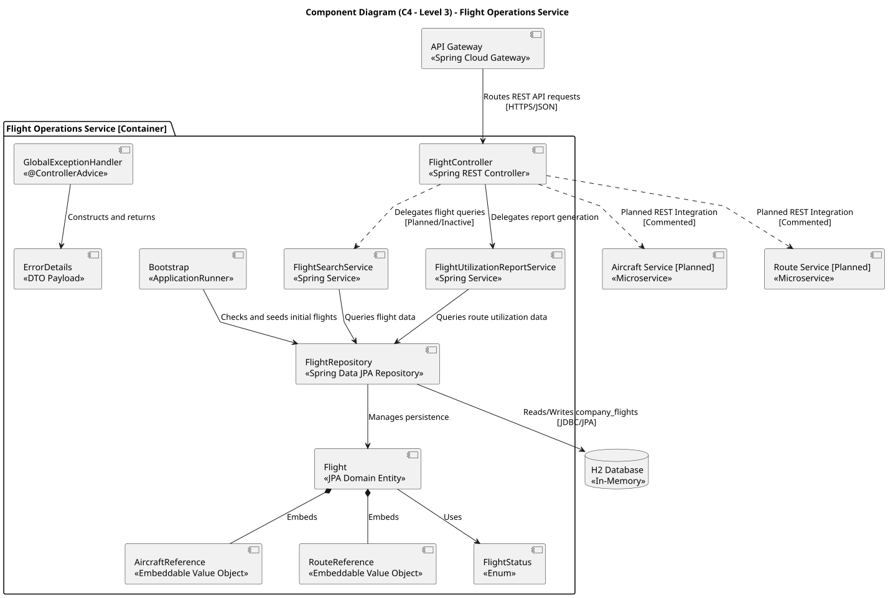

# Flight Operations Service (`flight-service`) — C4 Level 3 Component Diagram

This document describes the internal component architecture of the **Flight Operations Service** (`flight-service`) at C4 Level 3. It details how the internal controllers, domain services, JPA repositories, and external REST skeleton interfaces interact to deliver flight operational capabilities within the **AISafe Flight Management System**.

---

## 1. System Context & Component Responsibilities

The `flight-service` component manages flight schedules, status transitions, route utilization metrics, and operational checks against external services.

* **`FlightController` / `FlightUtilizationController`:** Primary REST controllers handling inbound HTTP endpoints under `/api/flights/**`.
* **`FlightService` (Domain Logic):** Core business logic layer responsible for optimistic locking, schedule validations, and metric aggregation.
* **`FlightRepository`:** Spring Data JPA interface managing persistence for the `company_flights` table in the H2 Database.
* **External REST Skeletons (`RestClient`):** Interfaces invoking external bounded contexts (`route-service`, `aircraft-service`, `maintenance-service`, and `airport-service`) for pre-flight validation.

---

## 2. Architecture Diagram

---

## 3. Data Flow & Inter-Service Dependencies

1. **Inbound Routing:** Requests sent to `/api/flights/**` enter through the `API Gateway`, which routes traffic directly to `Flight Operations Service` (Ports `8111-8120`).
2. **Pre-Flight Validation:** When scheduling a flight, `Flight Operations Service` issues synchronous `RestClient` calls to:
   * **`Route Service`:** To validate the route existence and total distance.
   * **`Aircraft Service`:** To check aircraft range capacity and operational availability.
   * **`Maintenance Service`:** To ensure no overlapping maintenance windows exist.
   * **`Airport Service`:** To verify origin and destination airport specs.
3. **Internal Calculations:** `Aircraft Service` queries accumulated flight metrics from `Flight Operations Service` to evaluate upcoming maintenance intervals.